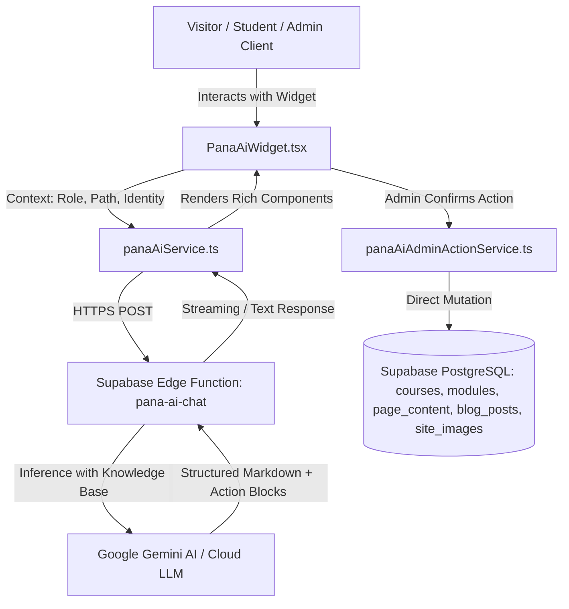

# PANA AI Technical & Administrator Documentation

**PANA AI** is the native intelligent co-instructor, site navigation guide, and administrative execution assistant for **PANA Institute** (PANA Energy Services Ltd). 

Built directly into the application, PANA AI operates with contextual awareness of user authentication roles, active page locations, live database schemas, and administrative privileges.

---

## 1. High-Level Architecture



### Core Architecture Components:
1. **Frontend Interface (`PanaAiWidget.tsx`):**
   - Tidio/Intercom-inspired floating widget with Home tab, Live Chat tab, context quick-suggestions, and device upload input.
   - Proactive timed visitor teaser bubble (triggers after 10 seconds for prospective learners).
   - Dynamic parsers for custom administrative action blocks (`change_text`, `change_image`, `publish_course`, `publish_news`).
2. **Client Service (`panaAiService.ts`):**
   - Transmits message history, current route path, user role, and user display name to the edge backend with fallback recovery.
3. **Edge Proxy (`supabase/functions/pana-ai-chat/index.ts`):**
   - Secure serverless endpoint verifying authentication and keeping Gemini API keys protected server-side.
4. **Knowledge System & Persona (`panaAiKnowledge.ts`):**
   - Comprehensive institute domain repository, courses, certification verification guidelines, and role-based instruction sets.
5. **Administrative Action Execution Engine (`panaAiAdminActionService.ts`):**
   - Real-time search across CMS tables (`courses`, `modules`, `page_content`, `pages`, `blog_posts`, `platform_settings`, `site_images`, `team_members`).
   - Smart course upsert, course price adjustment, brochure syllabus parsing, and direct image asset re-linking.

---

## 2. Role-Based Personalities & Access Levels

| Role | Persona & Capabilities | Interactive Tools |
| :--- | :--- | :--- |
| **Visitor / Guest** | Helpful academic guide & course advisor. Informs visitors about accreditations, corporate packages, certifications, and course recommendations. Proactively initiates chat after 10s dwell time. | Browse Courses quick links, Verify Certificate, Contact Inquiries. |
| **Student** | 24/7 personal co-instructor & academic mentor. Explains complex engineering concepts (SCADA, HAZOP, process loops, valves, reliability), tracks milestones, and clarifies assignments. | Navigation to My Courses, Assignments, and Verified Certificates. |
| **Instructor** | Curriculum planner and co-designer. Helps create lesson structures, module rubrics, and technical engineering quiz questions. | Course review shortcuts, student submission guides. |
| **Administrator** | Supercharged management copilot. Can inspect operational metrics, modify website text, change images, update course prices, and publish complete curriculums from brochures. | Action confirmation cards for website content, pricing, images, and catalog publishing. |

---

## 3. Administrator Action Execution Engine

When an authenticated administrator asks PANA AI to perform site updates, PANA AI generates structured action cards directly in the chat stream:

### A. Live Website Text Updates
- **Trigger:** *"Change Abuja phone number to +234 702 600 0000"*, *"Update About mission statement"*, etc.
- **Action Block:**
  ```json
  ```action:change_text
  {
    "target": "phone",
    "replacement": "+234 702 600 0000"
  }
  ```
  ```
- **Execution:** PANA AI searches across `page_content`, static page defaults, `platform_settings`, and `pages`. The admin reviews matching elements and clicks **"Confirm & Apply to Website"** to immediately update the live site.

### B. Course Price Updates via Course Code
- **Trigger:** *"Change SC05 price to 50000"*, *"Update course fee for EX13 to 75000"*, etc.
- **Action Block:**
  ```json
  ```action:change_text
  {
    "target": "SC05 price",
    "replacement": "50000"
  }
  ```
  ```
- **Execution:** Token extraction identifies course code `SC05` and field `price`. Selecting confirm automatically updates the `price` column, clears `is_price_tbd`, and recalculates `is_free`.

### C. Website Image Replacement
- **Trigger:** *"Replace hero banner"*, *"Change website logo"*, or uploading an image from device.
- **Action Block:**
  ```json
  ```action:change_image
  {
    "target": "hero",
    "newImageUrl": "https://.../uploaded.png"
  }
  ```
  ```
- **Execution:** Matches image slots across `site_images`, `courses`, `blog_posts`, and `team_members`. Administrators can either provide an image URL or upload directly from their computer/phone to update the live banner.

### D. Brochure Course Extraction & Publishing
- **Trigger:** Uploading a course document flyer, brochure PDF/Word file, or saying *"Publish course EX13 Reliability Centred Maintenance"*.
- **Action Block:**
  ```json
  ```action:publish_course
  {
    "code": "EX13",
    "title": "Reliability centred maintenance and FMECA",
    "description": "Comprehensive course description...",
    "category": "EPMICE Field Operations and Lifecycle Services",
    "level": "intermediate",
    "duration_hours": 28,
    "award": "Certificate of Competence",
    "learning_outcomes": ["..."],
    "target_audience": ["..."],
    "practical_work": ["..."],
    "standards": ["SAE JA1011", "IEC 60812", "ISO 14224"],
    "oem_partners": ["Baker Hughes", "Siemens Energy"],
    "thumbnail_url": "https://.../brochure.png",
    "modules": [
      { "title": "Day 1: RCM Principles & FMECA Analysis", "order_index": 1 },
      { "title": "Day 2: Proactive Maintenance Selection", "order_index": 2 }
    ]
  }
  ```
  ```
- **Smart Upsert Logic:**
  - If the course **is new**: Inserts the course record into `courses` with `status = 'published'` and inserts all day-by-day modules into `modules`.
  - If the course **already exists**: Updates the existing course description, duration, standards, and thumbnail without generating duplicates, and resynchronizes the modules cleanly.

### E. News & Press Release Direct Publishing
- **Trigger:** *"Publish news: PANA Institute signs partnership with Baker Hughes"*.
- **Action Block:**
  ```json
  ```action:publish_news
  {
    "title": "PANA Institute Expands Baker Hughes Partnership",
    "category": "news",
    "excerpt": "Expanding industrial asset integrity training across West Africa.",
    "content": "<p>Article text here...</p>",
    "cover_image": ""
  }
  ```
  ```
- **Execution:** Generates a unique SEO slug and commits the article directly to `blog_posts` with `published = true`.

---

## 4. Proactive Guest Engagement Rules

To convert visitors into enrolled learners without disrupting user experience:
1. **Dwell Time Rule:** After **10 seconds** of visitor activity on any page, a non-intrusive teaser card slides in above the launcher:
   > *"👋 Looking for a specific engineering certification or corporate training program? I can recommend the right course for you!"*
2. **Session Persistence:** If dismissed via the `✕` icon, the state is persisted in `sessionStorage` (`pana_guest_teaser_dismissed = true`) to prevent repetitive interruptions during that browsing session.
3. **Exclusion:** The teaser is completely suppressed for authenticated students, instructors, and administrators.

---

## 5. Security & Governance Policies

1. **Brand Standard Enforcement:**
   - Always referred to strictly as **"PANA Institute"** (forbidden: *"PANA Academy"*, *"PANA Institute & Academy"*).
2. **Strict Route Governance:**
   - Forbidden: Links to `/training-calendar`. All scheduling and course discovery directs to `/courses`.
3. **Formatting Constraints:**
   - PANA AI cleans markdown headers (no `###` or `##` at line starts) in favor of bold callouts and readable lists.
4. **Role Isolation:**
   - Action confirmation cards are only rendered if the active user profile has `role === 'admin'`. Non-admin users cannot trigger database modifications.
